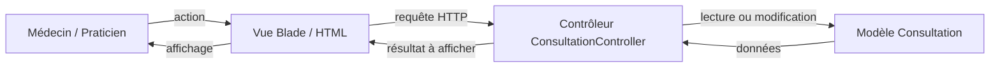
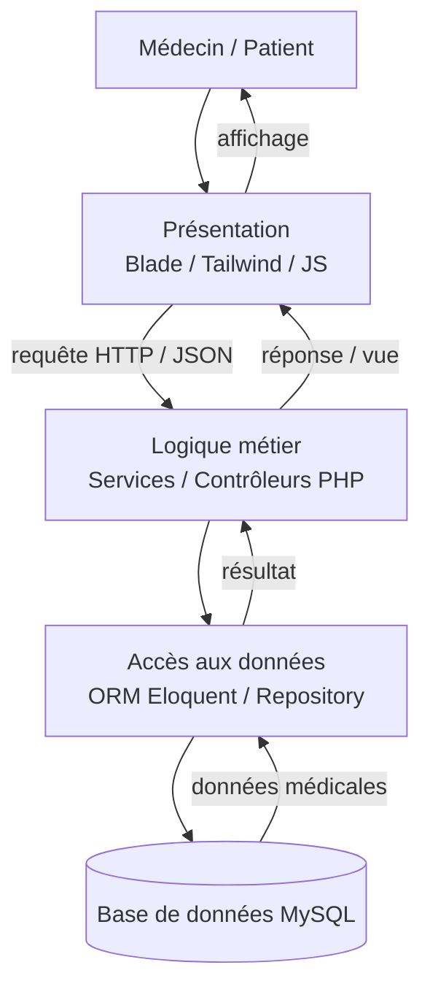
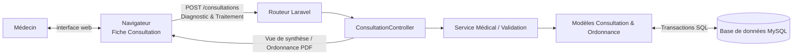

# Architecture logicielle

## Architecture MVC

Le modèle **MVC** (Modèle - Vue - Contrôleur) structure l'application en séparant clairement les responsabilités en trois couches distinctes :

- **Modèle** : représente les données métier et les règles de gestion médicales (ex : `Consultation`, `Patient`, `Spécialité`, `Ordonnance`).
- **Vue** : affiche les interfaces utilisateurs et recueille les actions (dossier patient, interface de consultation, formulaire d'ordonnance).
- **Contrôleur** : réceptionne les requêtes utilisateurs, traite les flux avec les modèles médicaux et transmet les données à la vue appropriée.

_Figure 1 — Échange MVC : le contrôleur coordonne la vue et le modèle lors de la gestion d'une consultation médicale._

Dans notre application de cabinet médical, l'architecture MVC assure la cohérence des données de santé, où la classe **Consultation** constitue le point d'ancrage central reliant le patient, le diagnostic et l'ordonnance.

## Architecture 3-tiers

L'architecture 3-tiers divise l'application en trois niveaux logiques bien découplés :

- **Niveau Présentation** : interface web ergonomique (Blade, Tailwind CSS, Alpine.js) permettant au personnel soignant de piloter les consultations et dossiers patients.
- **Niveau Logique Métier (Application)** : traitement des règles médicales (validation des prescriptions d'ordonnances, gestion des rendez-vous et téléconsultations, filtrage par spécialité).
- **Niveau Accès aux Données** : persistance et requêtage sécurisé des données médicales dans MySQL via l'ORM Eloquent ou les DAO.

_Figure 2 — Les trois tiers : séparation entre l'interface utilisateur, la logique métier et la base de données médicale._

## Flux de traitement d'une consultation médicale

Le déroulement standard d'une consultation et de l'émission d'une ordonnance s'articule comme suit :

_Figure 3 — Flux d'une requête de création d'une consultation et de son ordonnance._

1. Le médecin saisit les informations de la consultation (motif, diagnostic, notes cliniques) et rédige l'ordonnance.
2. Le routeur achemine la requête vers `ConsultationController`.
3. Le contrôleur valide les données et fait appel aux modèles `Consultation` et `Ordonnance` pour enregistrer l'acte médical et sa prescription dans MySQL.
4. Le système génère la vue de synthèse ainsi que l'ordonnance prête à être imprimée ou transmise au patient.
