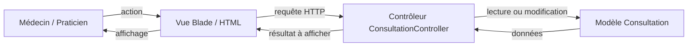
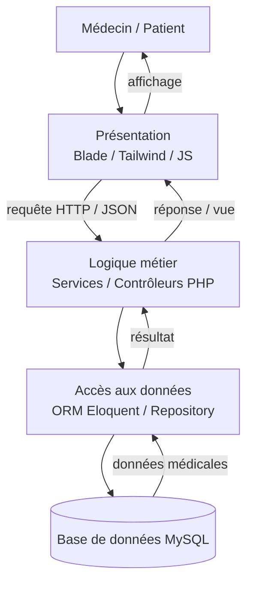
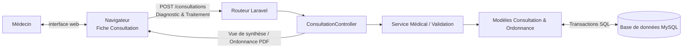

# Rapport

#### Table des matières

- [Remerciements](#remerciements)
- [Introduction](#introduction)
- [Contexte du projet](#contexte-du-projet)
- [Objectif de formation (Solicode)](#objectif-de-formation-solicode)
- [Cahier des charges](#cahier-des-charges)
- [Méthodologie de travail](#mthodologie-de-travail)
  - [Méthodologie Scrum](#mthodologie-scrum)
  - [Processus 2TUP](#processus-2tup)
  - [Design Thinking](#design-thinking)
- [Planification](#planification)
- [Branche fonctionnelle](#branche-fonctionnelle)
  - [Carte d'empathie](#carte-dempathie)
  - [Définition du problème](#dfinition-du-problme)
  - [Idéation](#idation)
  - [Diagramme de cas d'utilisation](#diagramme-de-cas-dutilisation)
- [Branche technique](#branche-technique)
  - [Stack technologique](#stack-technologique)
  - [Architecture logicielle](#architecture-logicielle)
  - [Prototype (fonctionnalités, classes)](#prototype-fonctionnalits-classes)
- [Conception](#conception)
  - [Diagramme de classes](#diagramme-de-classes)
  - [Maquettes](#maquettes)
- [Réalisation](#ralisation)
  - [Interfaces](#interfaces)
- [Conclusion](#conclusion)

## Remerciements

## Introduction

## Contexte du projet

## Objectif de formation (Solicode)

Ce projet de fin d'études / fil rouge s'inscrit dans le cadre de la formation au sein de **Solicode**. Il a pour objectif de valider et consolider l'ensemble des compétences techniques et méthodologiques acquises durant le parcours :

- Maîtrise des méthodes agiles (**Scrum**) et du processus unifié (**2TUP**).
- Application de la démarche centrée utilisateur (**Design Thinking**).
- Conception et modélisation orientée objet (diagrammes UML).
- Développement full-stack en architecture **MVC** avec **Laravel** et technologies modernes.
- Gestion professionnelle des versions de code avec **Git / GitHub**.

## Cahier des charges

## Méthodologie de travail

### Méthodologie Scrum

#### Méthode de travail

##### La méthode SCRUM

La méthodologie Scrum est une méthodologie agile qui permet de gérer un projet de manière flexible et collaborative, en favorisant la livraison progressive de fonctionnalités. Elle repose sur l'itération, la priorisation des tâches et la communication régulière entre les membres de l'équipe. Dans le cadre de ce projet de **Cabinet Médical / Téléconsultation**, nous avons organisé le travail selon les principes de Scrum, ce qui nous a permis de mieux planifier, suivre et livrer les différentes fonctionnalités de manière efficace et sécurisée.

*Figure 3 : La méthode SCRUM*

**Principe Scrum :**

- **Transparence** : visibilité complète sur les tâches, les objectifs et l'avancement du projet pour toute l'équipe.
- **Inspection** : évaluation régulière à la fin de chaque sprint afin d'identifier les erreurs, les blocages et les axes d'amélioration.
- **Adaptation** : ajustement du plan de travail en fonction des retours et des résultats obtenus lors des sprints.

**Organisation du projet en sprints :**

###### Sprint 1 : Gestion des patients et des spécialités médicales

- Modélisation de la base de données médicale et configuration de l'architecture.
- Développement du module de gestion des patients (dossiers médicaux, coordonnées).
- Développement du CRUD pour la classification des spécialités médicales.

###### Sprint 2 : Gestion des consultations et émission des ordonnances

- Développement du CRUD complet pour la classe principale **Consultation** (planification, diagnostic, statut).
- Mise en place du module de génération et liaison des **Ordonnances** aux consultations correspondantes.
- Tests fonctionnels du prototype médical et validation des flux de données.

### Processus 2TUP

##### 2.3 2TUP

###### Définition

La méthode **2TUP** (*Two Tracks Unified Process*) est une méthode de développement logiciel agile et itérative. Elle est parfaitement adaptée au contexte de notre projet de **Cabinet Médical / Téléconsultation**, à ses exigences de confidentialité des données de santé et aux besoins des **praticiens et patients**.

Sa particularité repose sur une architecture en « Y » qui sépare distinctement deux axes de réflexion :

- **la branche fonctionnelle**, consacrée à la compréhension des utilisateurs, des processus médicaux et des besoins métier (prise en charge du patient, consultations, téléconsultation, prescription d'ordonnances) ;
- **la branche technique**, consacrée à l'étude des contraintes techniques, à la sécurité des données médicales, à la conception de l'architecture et au choix des technologies.

La branche fonctionnelle permet de définir les **fonctionnalités clés telles que la gestion des consultations médicales, le suivi des patients, la délivrance des ordonnances et la classification par spécialité**, tandis que la branche technique permet de déterminer l'architecture et les outils nécessaires, tels que **PHP / Laravel, MySQL, Tailwind CSS et l'architecture MVC**.

Ces deux branches progressent en parallèle, puis se rejoignent dans une phase de réalisation. Cette organisation permet de limiter les risques, de vérifier la cohérence entre les besoins métier et la solution technique, et de faire évoluer progressivement le produit.

###### Schéma

Le schéma suivant présente le fonctionnement général de la méthode 2TUP appliquée à notre application de cabinet médical et téléconsultation.

**Figure 2 : Processus 2TUP appliqué au projet Cabinet Médical / Téléconsultation**

La branche fonctionnelle part de la capture des besoins et aboutit à l'analyse fonctionnelle. En parallèle, la branche technique part des besoins techniques et aboutit à la définition de l'architecture et des technologies. La convergence des deux branches déclenche la phase de réalisation, qui comprend la conception, le codage, les tests, la recette et le déploiement.

###### Conclusion

La méthode 2TUP fournit un cadre de travail structuré et adaptable pour la réalisation du projet **Cabinet Médical / Téléconsultation**. La séparation entre les branches fonctionnelle et technique facilite la compréhension des flux médicaux et permet de prendre les décisions techniques au moment opportun.

En réunissant ces deux branches dans une phase de réalisation progressive, la méthode favorise la maîtrise des risques liés à la sécurité des données de santé, l'amélioration continue et l'alignement du produit final sur les besoins des **professionnels de santé et des patients**.

### Design Thinking

Ainsi, l’adoption de la méthode Scrum a permis d’assurer une organisation efficace du travail et une meilleure gestion du projet. Elle a contribué à améliorer la qualité des fonctionnalités développées et à garantir un déroulement structuré du projet de **Cabinet Médical / Téléconsultation**.

##### Design thinking

Le Design Thinking est une approche de résolution de problèmes centrée sur l’humain. Elle vise à comprendre en profondeur les besoins réels des utilisateurs (médecins, personnel médical et patients) afin de concevoir des solutions innovantes, utiles et adaptées aux exigences du secteur de la santé. Cette méthode est largement utilisée dans les domaines du design, de la technologie, de l’éducation et de l’innovation pour répondre à des problématiques complexes.

  

*Figure : Méthodologie Design Thinking*

Le Design Thinking est particulièrement utilisé pour :

- Encourager la créativité et l’innovation dans la conception de solutions médicales digitales ;
- Proposer des réponses réellement adaptées aux besoins des praticiens et des patients ;
- Favoriser la collaboration entre différentes équipes de travail ;
- Résoudre des problèmes complexes ou mal définis de manière structurée.

##### Les étapes du Design Thinking

Le processus du Design Thinking se compose de plusieurs étapes essentielles :

- **Empathie (Empathize)** : cette étape consiste à comprendre l’utilisateur en l’observant, en l’interrogeant et en analysant son comportement. L’objectif est d’identifier les attentes des patients (facilité d'accès aux soins, suivi à distance) et les contraintes des médecins (gestion du temps, traçabilité des consultations et ordonnances).
- **Définition du problème (Define)** : elle permet de regrouper les informations collectées afin de formuler un problème clair et centré sur l’utilisateur, souvent exprimé sous forme de question comme : « Comment fluidifier la prise de rendez-vous, le déroulement des consultations médicales et la délivrance d'ordonnances pour un cabinet moderne ? »
- **Idéation (Ideate)** : cette phase consiste à générer un maximum d’idées possibles sans jugement, en utilisant des techniques comme le brainstorming ou le mind mapping afin de concevoir des parcours de téléconsultation simples et intuitifs.
- **Prototype** : elle consiste à créer une version simplifiée de la solution proposée (maquette, interface ou modèle de données pour consultations et ordonnances) afin de tester rapidement les idées.
- **Test** : cette dernière étape permet de tester le prototype auprès des praticiens et utilisateurs, de recueillir leurs retours et d’améliorer la solution en fonction des résultats obtenus.

Le Design Thinking est donc une méthode structurée et flexible qui permet de transformer une idée en solution concrète en mettant toujours l’utilisateur au centre du processus.

## Planification

## Branche fonctionnelle

### Carte d'empathie

### Définition du problème

### Idéation

### Diagramme de cas d'utilisation

## Branche technique

Dans cette section, nous présentons la **branche technique** de notre projet de **Cabinet Médical / Téléconsultation**. Elle consiste à décrire les choix technologiques, l'architecture logicielle retenue ainsi que le prototype technique développé pour valider la prise en charge médicale, les consultations et la gestion des ordonnances.

### Stack technologique

Dans le cadre de ce projet de **Cabinet Médical / Téléconsultation**, plusieurs technologies modernes et complémentaires ont été sélectionnées pour garantir la performance, la sécurité renforcée des données de santé, la maintenabilité et l'ergonomie de l'application.

###### Technologies Backend

- **PHP 8.2+ et Laravel 12.0** : Ce duo technologique est utilisé pour développer le backend en architecture MVC, garantissant un environnement sécurisé, robuste et structuré pour la manipulation des dossiers patients et des consultations.
- **Spatie Laravel Permission** : Gestion rigoureuse des rôles et des autorisations médicales (Médecin, Secrétaire médicale, Patient).
- **API RESTful** : Architecture de services pour la communication sécurisée entre les interfaces web et la logique métier de l'application.

###### Technologies Frontend

- **Blade Templates** : Moteur de rendu HTML natif de Laravel, utilisé pour structurer les vues sous forme de composants modulaires et réutilisables (fiches patients, tableaux de bord de consultations, générateurs d'ordonnances).
- **Tailwind CSS** : Framework CSS utilitaire permettant de concevoir une interface sur mesure, moderne, responsive et claire pour les praticiens.
- **Alpine.js** : Framework JavaScript léger et réactif, utilisé pour le dynamisme du frontend (recherche rapide de patients, modales de consultation, filtres par spécialité médicale).
- **Vite** : Outil de build moderne optimisant la compilation des ressources CSS et JavaScript pour des temps de chargement minimes.

###### Base de données

- **MySQL** : Système de gestion de base de données relationnelle (SGBDR) fiable, utilisé pour stocker l'ensemble des données médicales (patients, spécialités, consultations, ordonnances).

###### Outils de modélisation et de conception

- **Mermaid & PlantUML** : Outils de génération textuelle de diagrammes utilisés pour modéliser le domaine médical (diagrammes de classes, flux de consultation, architecture logicielle).

### Architecture logicielle

##### Architecture MVC

Le modèle **MVC** (Modèle - Vue - Contrôleur) structure l'application en séparant clairement les responsabilités en trois couches distinctes :

- **Modèle** : représente les données métier et les règles de gestion médicales (ex : `Consultation`, `Patient`, `Spécialité`, `Ordonnance`).
- **Vue** : affiche les interfaces utilisateurs et recueille les actions (dossier patient, interface de consultation, formulaire d'ordonnance).
- **Contrôleur** : réceptionne les requêtes utilisateurs, traite les flux avec les modèles médicaux et transmet les données à la vue appropriée.

_Figure 1 — Échange MVC : le contrôleur coordonne la vue et le modèle lors de la gestion d'une consultation médicale._

Dans notre application de cabinet médical, l'architecture MVC assure la cohérence des données de santé, où la classe **Consultation** constitue le point d'ancrage central reliant le patient, le diagnostic et l'ordonnance.

##### Architecture 3-tiers

L'architecture 3-tiers divise l'application en trois niveaux logiques bien découplés :

- **Niveau Présentation** : interface web ergonomique (Blade, Tailwind CSS, Alpine.js) permettant au personnel soignant de piloter les consultations et dossiers patients.
- **Niveau Logique Métier (Application)** : traitement des règles médicales (validation des prescriptions d'ordonnances, gestion des rendez-vous et téléconsultations, filtrage par spécialité).
- **Niveau Accès aux Données** : persistance et requêtage sécurisé des données médicales dans MySQL via l'ORM Eloquent ou les DAO.

_Figure 2 — Les trois tiers : séparation entre l'interface utilisateur, la logique métier et la base de données médicale._

##### Flux de traitement d'une consultation médicale

Le déroulement standard d'une consultation et de l'émission d'une ordonnance s'articule comme suit :

_Figure 3 — Flux d'une requête de création d'une consultation et de son ordonnance._

1. Le médecin saisit les informations de la consultation (motif, diagnostic, notes cliniques) et rédige l'ordonnance.
2. Le routeur achemine la requête vers `ConsultationController`.
3. Le contrôleur valide les données et fait appel aux modèles `Consultation` et `Ordonnance` pour enregistrer l'acte médical et sa prescription dans MySQL.
4. Le système génère la vue de synthèse ainsi que l'ordonnance prête à être imprimée ou transmise au patient.

### Prototype (fonctionnalités, classes)

Avant d'entamer le développement complet du projet principal, j'ai réalisé un projet technique servant de prototype fonctionnel (Proof of Concept) : une application web de **Cabinet Médical / Téléconsultation**. Ce prototype permet aux praticiens de gérer les consultations médicales, les dossiers des patients, les ordonnances et la classification par spécialité médicale.

La plateforme permet à un cabinet médical de centraliser la prise en charge des patients, d'assurer le suivi des consultations (en présentiel ou à distance) et de délivrer des ordonnances médicales de façon structurée.

##### Fonctionnalités Clés

- **Gestion des Patients (Patient Management) :** Création, consultation, mise à jour et suivi des dossiers patients (nom, prénom, coordonnées, antécédents) avec opérations CRUD complètes.
- **Gestion des Consultations (Consultation Management - Classe principale) :** Planifier, enregistrer, modifier et suivre les consultations médicales (motif, date/heure, type : présentiel ou téléconsultation, diagnostic, statut).
- **Gestion des Spécialités (Spécialité Management - Classe de classification) :** Créer, modifier et organiser les spécialités médicales (ex : Médecine générale, Cardiologie, Dermatologie, Pédiatrie) pour catégoriser les actes et consultations.
- **Gestion des Ordonnances (Ordonnance Management) :** Générer, modifier et associer des ordonnances médicales (médicaments, posologie, durée de traitement) directement rattachées aux consultations.

##### Classes principales du modèle

- **Consultation (Classe principale) :** Représente l'acte médical ou la séance de téléconsultation liant le patient, le médecin, le diagnostic et les prescriptions.
- **Spécialité (Classe de classification) :** Permet de classer et catégoriser les consultations selon le domaine médical concerné.
- **Patient :** Représente le patient bénéficiaire des soins et consultations médicales.
- **Ordonnance :** Représente la prescription médicale détaillée délivrée à l'issue d'une consultation.

##### Relations principales

- **Patient ↔ Consultation :** Relation **One-to-Many (1:N)** — Un patient peut effectuer plusieurs consultations au fil du temps, mais chaque consultation est attribuée à un seul patient.
- **Spécialité ↔ Consultation :** Relation **One-to-Many (1:N)** — Une spécialité médicale regroupe plusieurs consultations, et chaque consultation est rattachée à une spécialité précise.
- **Consultation ↔ Ordonnance :** Relation **One-to-One (1:1)** (ou **One-to-Many (1:N)**) — Une consultation médicale donne lieu à l'émission d'une ordonnance contenant les prescriptions adaptées au diagnostic.

## Conception

### Diagramme de classes

### Maquettes

## Réalisation

### Interfaces

## Conclusion
